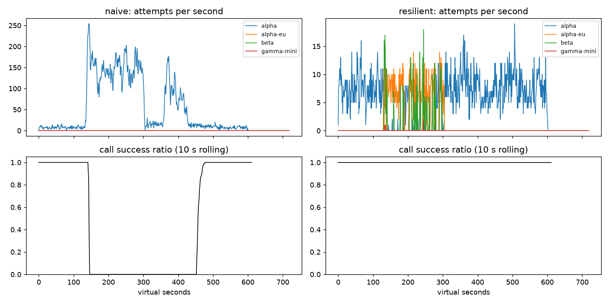

# Lab 25B — Report

**Họ tên / nhóm:** Nguyễn Văn Hưởng — **MSV:** 2A202602743  
**Commit:** `5a86ca83e25b9a8b29ab2c0320a8e439f4e34078` (snapshot mã nguồn A–G đã kiểm chứng; report/kết quả chấm ở các commit tiếp theo).
**HEAD nguồn:** `a3f9ce7078c14d183ed1e95d311a2df59bc86855` (starter gốc trước các commit bài làm)  
**Điểm tự động (`make grade`):** 84 / 88 (4 điểm SLO hidden chờ giảng viên; report chấm tay /12)

> Mọi nhận định phải có số. Dán số từ `reports/gameday/*.json`, `reports/workflows.json`, `reports/slo.json`.

> Hoàn thiện Part A–G, đối chiếu `docs/RUBRIC.md`. Các số liệu là kết quả mô phỏng local; băng ẩn và điểm report do giảng viên chấm. Hash snapshot đầy đủ sẽ được cập nhật sau khi commit toàn bộ report và kết quả chấm.

## 1. Kết quả Game Day (naive vs của bạn)

Chạy `make compare PY=.venv/bin/python`, seed mô phỏng 25. Availability và retry_ratio
là tỷ lệ 0–1; chi phí là đơn vị mô phỏng. p95 chỉ tính trên lượt user thành công.

| Băng | Client    | availability | p95 (s) | amplification | retry_ratio | cost/turn | recovery (s) | PASS? |
| ---- | --------- | -----------: | ------: | ------------: | ----------: | --------: | -----------: | :---: |
| G1   | naive     |       0.7194 |   7.157 |         7.738 |       6.738 |     2.163 |          4.0 | FAIL  |
| G1   | resilient |          1.0 |   4.738 |         1.063 |       0.002 |     2.106 |          0.0 | PASS  |
| G2   | naive     |        0.456 |  15.034 |         9.904 |       8.904 |     4.627 |        155.0 | FAIL  |
| G2   | resilient |          1.0 |   8.896 |         1.048 |       0.009 |     2.142 |          0.0 | PASS  |
| G3   | naive     |          1.0 |   4.768 |         1.164 |       0.164 |     2.328 |          0.0 | FAIL  |
| G3   | resilient |          1.0 |   4.714 |         1.059 |       0.025 |     2.139 |          0.0 | PASS  |
| G4   | naive     |          1.0 |  13.764 |         1.004 |       0.004 |     2.008 |          0.0 | FAIL  |
| G4   | resilient |          1.0 |   5.483 |         1.031 |       0.004 |      2.11 |          0.0 | PASS  |
| G5   | naive     |       0.3699 |   5.359 |         17.03 |       16.03 |     2.124 |            — | FAIL  |
| G5   | resilient |       0.8179 |   5.477 |         1.003 |       0.003 |     2.504 |            — | PASS  |
| G6   | naive     |        0.517 |   4.836 |        12.344 |      11.344 |     2.009 |          0.0 | FAIL  |
| G6   | resilient |       0.9987 |   5.863 |         1.052 |       0.018 |     2.225 |          0.0 | PASS  |

Naive: **0/6 PASS**; resilient: **6/6 PASS**. G2 giảm amplification từ 9,904
xuống 1,048, availability tăng từ 45,60% lên 100%, recovery giảm từ 155 xuống 0 s.
Recovery 0 s nghĩa là cửa sổ 30 s bắt đầu ngay tại thời điểm provider hồi phục
đã có ≥95% LLM call thành công; không có nghĩa mọi request hồi phục tức thì.
G5 đạt 81,79% do lỗi malformed phải bị từ chối, không thể cứu bằng retry.

Kiểm chứng bổ sung: 6 băng × seed 25, 7, 42 = **18/18 PASS** với cấu hình đã chọn.
Số liệu từng lần chạy và ba cấu hình thử nghiệm: `gameday/client_tuning.json`.
Đây là các băng public; chưa có kết quả băng ẩn của giảng viên.

## 2. Cấu hình client và lý do

Chỉ có một tầng retry tại `ResilientClient.on_error`; simulator/provider không được
thêm tầng retry. Mỗi logical call nạp budget một lần trong `start`. Mỗi lần thử lại
provider đã dùng phải có token; kể cả nhánh chờ rate limit cũng có giới hạn attempt.
Mọi quyết định dùng thời gian ảo `now`, cooldown được chia sẻ theo deployment.

| Tham số                                            |    Giá trị | Vì sao (dựa trên băng nào, số liệu nào)                                                                                                                         |
| -------------------------------------------------- | ---------: | --------------------------------------------------------------------------------------------------------------------------------------------------------------- |
| attempt_timeout_s                                  |        6,0 | Thử 8 → 6 s: G2 p95 9,847 → 8,896 s; G6 p95 6,099 → 5,954 s khi giữ budget ban đầu. Chừa thời gian fallback trong deadline 30 s.                                |
| max_attempts_per_provider                          |          2 | Tối đa một lần thử lại trên mỗi deployment cho một call; G2 amplification cuối 1,048, G6 1,052, đều ≤1,6.                                                       |
| min_time_left_s                                    |        1,0 | Không gửi nếu còn dưới 1 s sau delay; `_send` luôn cắt timeout theo deadline. Test deadline và retry-after không vừa deadline đều pass.                         |
| backoff_base_s / cap_s                             | 0,25 / 4,0 | Full jitter trải thời điểm retry, tránh retry đồng loạt. G1 retry-after violations = 0; G2 amplification 1,048. Đây là giá trị giữ lại, chưa chứng minh tối ưu. |
| retry_budget_ratio                                 |       0,05 | Giảm đồng thời ratio 0,10 → 0,05 và refill 0,5 → 0,1 ở timeout 6 s: G3 retry ratio 0,035 → 0,025 và amplification 1,065 → 1,059, availability vẫn 100%.         |
| retry_budget_min_per_s / max_tokens                |   0,1 / 20 | Giảm refill thời gian từ 0,5 → 0,1 token/s cùng với ratio 5%; giữ burst 20 token. G6 availability 99,87% và amplification 1,052; 18/18 băng đa seed pass.       |
| quota_cooldown_s                                   |        300 | Quota không thể sửa bằng retry; cooldown dài rồi failover. G5 retry lỗi 400 = 0, unneeded_failovers = 0.                                                        |
| breaker.window_size / min_calls                    |    20 / 10 | Giữ cửa sổ gần nhất, chờ đủ mẫu trước khi trip; G2/G4 đạt tiêu chí và G5 không failover vì lỗi 400.                                                             |
| breaker.failure_rate_threshold                     |        0,5 | Trip khi ≥50% kết quả gần nhất là lỗi sức khỏe provider. G2 recovery 0 s; G3 dùng cả retry có budget và fallback, availability 100%.                            |
| breaker.slow_call_s / slow_rate_threshold          |  5,0 / 0,6 | Call thành công nhưng ≥5 s cũng là tín hiệu xấu; G4 p95 5,483 s so với naive 13,764 s.                                                                          |
| breaker.open_duration_s                            |       10,0 | Cho provider nghỉ rồi probe lại; G2 recovery 0 s và traffic quay lại primary đạt ngưỡng ≥80%.                                                                   |
| breaker.half_open_max_probes / half_open_successes |      2 / 2 | Tối đa hai probe đang bay, cần hai thành công nhanh để đóng breaker. Test concurrency và stale generation đều pass.                                             |

Các tham số breaker giữ nguyên vì đã vượt qua bộ băng và ba seed; chưa có thí nghiệm
chứng minh chúng là cấu hình tối ưu. Giảm timeout có đánh đổi: ở G2, cost/good turn
của cấu hình 8 s ban đầu là 2,105, cấu hình cuối là 2,142; timeout sớm hơn có thể
để lại công việc provider vẫn đang xử lý. Giới hạn budget 5% không phải trần tuyệt đối
5%: bucket có burst ban đầu và refill theo thời gian.

Sơ đồ quyết định `on_error`:

| Loại lỗi                              | Ghi breaker?          | Retry cùng provider?                                                                              | Failover / cooldown                                                                                                  |
| ------------------------------------- | --------------------- | ------------------------------------------------------------------------------------------------- | -------------------------------------------------------------------------------------------------------------------- |
| CLIENT_ERROR (400 và lỗi client khác) | Không, release permit | Không                                                                                             | GiveUp; không failover                                                                                               |
| QUOTA_EXHAUSTED                       | Không, release permit | Không                                                                                             | Cooldown 300 s, failover ngay; không chờ quota                                                                       |
| RATE_LIMITED                          | Không, release permit | Không ngay                                                                                        | Cooldown theo retry-after, failover ngay; nếu hết lựa chọn chỉ chờ cooldown ≤5 s khi còn deadline, attempt và budget |
| OVERLOADED / SERVER_ERROR / TIMEOUT   | Có, on_failure        | Khi breaker chưa OPEN, còn attempt, budget và deadline; full jitter, tôn trọng retry-after nếu có | Failover khi không được retry                                                                                        |

`ladder("tool")` lọc `supports_tools`, nên không thể gửi tool call sang `gamma-mini`;
G6 incompatible_routes = 0. `on_success` ghi cả latency để bắt slow call.
`on_cancel` release permit, không giữ kẹt probe HALF-OPEN.

Kiểm tra: **57 test PASS**, gồm 11 test client gốc, 6 test biên cooldown/deadline,
Part A/B và simulator sanity; Ruff trên client và test mới pass.

## 3. Ba thí nghiệm

Chạy `.venv/bin/python scripts/run_report_experiments.py --seed 25` để tái tạo.
Nguồn đầy đủ: [report_experiments.json](report_experiments.json).
Script dùng bản sao cấu hình trong bộ nhớ; ablation tool calling chỉ nằm trong
subclass thí nghiệm, không sửa client nộp, scenarios hay cấu hình cuối.
Availability và retry_ratio là tỷ lệ 0–1; p95 chỉ tính lượt thành công.

### 3.1. Retry budget và breaker

Giữ timeout 6 s; **max_attempts_per_provider = 5 ở cả bốn cấu hình** để so sánh
cùng mức trần attempt. Breaker vô hiệu: `min_calls = 1000000000`; breaker bình thường:
window 20 / min_calls 10. Budget bật: ratio 0,05 / burst 20 / refill 0,1 token/s;
budget tắt: ratio 100 / burst 1e9 / refill 1e6 token/s.

| Breaker     | Budget | Băng | Availability | Amplification | Retry ratio | Recovery (s) |
| ----------- | ------ | ---- | -----------: | ------------: | ----------: | -----------: |
| vô hiệu     | bật    | G2   |          1.0 |         1.366 |       0.027 |          0.0 |
| vô hiệu     | bật    | G3   |          1.0 |         1.125 |        0.03 |          0.0 |
| vô hiệu     | tắt    | G2   |       0.9729 |         1.672 |       0.442 |         42.0 |
| vô hiệu     | tắt    | G3   |          1.0 |         1.162 |       0.158 |          0.0 |
| bình thường | bật    | G2   |          1.0 |         1.048 |       0.009 |          0.0 |
| bình thường | bật    | G3   |          1.0 |         1.048 |       0.026 |          0.0 |
| bình thường | tắt    | G2   |          1.0 |         1.048 |       0.009 |          0.0 |
| bình thường | tắt    | G3   |          1.0 |         1.036 |        0.02 |          0.0 |

Khi breaker vô hiệu, tắt budget làm G2 amplification tăng **1,366 → 1,672**,
retry_ratio **0,027 → 0,442**, recovery **0 → 42 s**, availability giảm
**100% → 97,29%** và có **64 deadline give-up**.
Ở G3 cùng điều kiện, retry_ratio tăng **0,030 → 0,158** dù availability vẫn 100%,
cho thấy retry dư có thể bị che bởi tỷ lệ thành công.
Budget giới hạn retry cả trước khi đủ mẫu trip breaker và khi breaker bị cấu hình
sai; burst ban đầu và refill theo thời gian vẫn cho phép một số retry.
Khi breaker hoạt động, G2 bật/tắt budget giống nhau, còn G3 tắt budget có retry_ratio
**0,020** so với **0,026** khi bật, với **34** so với **28** transition của alpha:
đường retry khác làm thay đổi thứ tự request và cửa sổ health, nên một seed không
chứng minh mọi metric luôn giảm khi bật budget.
Vẫn cần cả hai vì breaker ngăn gửi vào deployment không khỏe theo kết quả/latency,
còn budget đặt giới hạn retry trong giai đoạn chưa trip hoặc khi cấu hình breaker
không bắt được sự cố.

### 3.2. Timeout 30 s — G6 và đối chứng G4

Giữ toàn bộ cấu hình cuối, chỉ thay `attempt_timeout_s`; xem availability và lý do
bỏ cuộc trước khi so sánh p95.

| Băng | Timeout (s) | Availability | Give-up reasons (số call)                | p95 lượt thành công (s) |
| ---- | ----------: | -----------: | ---------------------------------------- | ----------------------: |
| G6   |         6.0 |       0.9987 | no_provider_available: 3                 |                   5.863 |
| G6   |          30 |       0.9484 | deadline: 107; no_provider_available: 16 |                   5.357 |
| G4   |         6.0 |          1.0 | không có                                 |                   5.483 |
| G4   |          30 |          1.0 | không có                                 |                   5.608 |

G6 timeout 30 s giảm availability **99,87% → 94,84%**, với **107 deadline** và
**16 no_provider_available**, so với chỉ **3 no_provider_available** ở timeout 6 s.
Fallback alpha-eu treo làm attempt chiếm hết thời gian còn lại của lượt, khiến
fallback không còn đủ deadline để cứu user.
P95 lại giảm **5,863 → 5,357 s** vì các lượt treo/thất bại bị loại khỏi tập tính
latency — đây là survivorship bias, không phải trải nghiệm user tốt hơn.
G4 vẫn đạt availability 100% và p95 chỉ đổi **5,483 → 5,608 s** vì provider vẫn trả
lời và slow-call breaker nhận ra latency ≥5 s để chuyển tải, không phải đợi timeout 30 s.
Timeout nên được kiểm chứng bằng p99 attempt lúc khỏe, deadline **30 s cho cả lượt**
và thời gian còn cần cho tool execution, LLM call tiếp theo cùng ít nhất một fallback;
ở các băng đã đo, mức 6 s giữ được availability và giảm tail latency so với 8 s.

### 3.3. Bỏ lọc tool calling

Giữ cấu hình cuối, chỉ thay `ladder()` trong subclass thí nghiệm để trả mọi deployment.

| Lọc tool capability | G6 availability | incompatible_routes | Give-up reasons                |
| ------------------- | --------------: | ------------------: | ------------------------------ |
| có                  |          0.9987 |                   0 | no_provider_available: 3       |
| không               |          0.8948 |                 251 | incompatible_model_output: 251 |

Bỏ lọc làm `incompatible_routes` tăng **0 → 251** và availability giảm
**99,87% → 89,48%** trên G6.
`gamma-mini` có thể trả chat nhưng không hỗ trợ tool calling, nên kết quả tool step
bị simulator đánh dấu không tương thích và lượt user thất bại.
Với product manager, 251 trường hợp này là 251 lượt agent không hoàn tất luồng xử lý
cho khách vì fallback không có khả năng thực hiện bước cần thiết.
Chi phí/call thấp 0,2 của gamma-mini không bù được việc bỏ mất chức năng tool.
Client nộp giữ lọc theo `ProviderInfo.supports_tools` cho tool, còn chat vẫn được
dùng cả bốn deployment theo thứ tự cấu hình.

## 4. Workflow hoàn tiền

Chạy `make workflows PY=.venv/bin/python`: 500 session, seed 25, có lỗi trước
execution, timeout sau commit và worker crash. Nguồn: `reports/workflows.json`.
Completion là tỷ lệ 0–1; overpaid tính bằng cents trong mô phỏng.

| Executor | completion | crashes | duplicate refunds | duplicate emails | lost refunds | overpaid (cents) | wasted LLM / crash |
| -------- | ---------: | ------: | ----------------: | ---------------: | -----------: | ---------------: | -----------------: |
| naive    |        1.0 |      81 |               128 |               81 |            0 |          1496700 |              1.123 |
| yours    |        1.0 |      66 |                 0 |                0 |            0 |                0 |              0.303 |

Executor mới hoàn tất **500/500**, thực thi payment **500 lần**, ghi **2.500 checkpoint**,
không hoàn tiền/email trùng, không mất hoàn tiền và không trả tiền dư. Trong **66 crash**,
chỉ lãng phí **20 LLM call**, nên wasted_llm_per_crash = **0,303**, đạt yêu cầu ≤0,6.
Naive cũng hoàn tất 100% nhưng có **128 refund trùng**, **81 email trùng** và trả dư
**1.496.700 cents**: completion một mình không đo được tính đúng của workflow.

**Idempotency key:** tạo từ JSON của `[session_id, step]` với prefix `refund:idem:`;
checkpoint dùng cùng cặp với prefix riêng `refund:checkpoint:`. Cùng session và step
luôn có cùng key sau retry/restart; encoding giữ ranh giới giữa session và step,
tránh collision khi chuỗi chứa dấu phân cách. Key payment/email được tính một lần
cho step và giữ nguyên trong tất cả attempt.

**Checkpoint và resume:** executor đọc tập key đã lưu, chạy `STEPS` theo thứ tự.
Step có checkpoint thì tải kết quả vào state và bỏ qua gọi service; step chưa có
checkpoint thì thực thi, đợi trả về thành công, rồi mới `store.put`. Retry chỉ bắt
`ServiceError` / `ServiceTimeout`, tối đa 5 attempt cho mỗi lần thực thi step;
hết attempt thì lỗi được truyền ra. `WorkerCrash` luôn truyền ra runner để khởi động
worker mới với cùng DurableStore và dịch vụ.

**Vì sao cần cả hai:** chỉ idempotency bảo vệ payment/email khỏi side effect trùng,
nhưng restart vẫn có thể chạy lại classify, lookup, summarize và tốn LLM call.
Chỉ checkpoint để lại khoảng trống khi payment đã commit nhưng worker chết trước
lúc ghi kết quả: worker mới thấy thiếu checkpoint và gọi payment lại. Kết hợp cả hai,
call lặp dùng cùng key lấy lại refund_id cũ rồi ghi checkpoint; effect vẫn chỉ xảy ra
một lần, dù endpoint có thể được gọi nhiều lần.

**Không checkpoint trước payment:** nếu ghi như thể step đã xong rồi crash trước
khi thực thi payment, worker mới sẽ skip step, dẫn đến không hoàn tiền hoặc dùng
kết quả không tồn tại. Checkpoint phải chứng minh step đã thành công, không chỉ là
ý định sẽ chạy step. Nếu crash sau LLM call nhưng trước checkpoint thì vẫn có thể
mất công tính toán; số 0,303 thể hiện phần lãng phí còn lại trong mô phỏng.

Kiểm tra: **7/7 test executor gốc PASS**, thêm **5 test biên PASS**: crash trước/sau
khi ghi checkpoint refund, response email bị mất sau commit, hết retry không ghi
checkpoint thành công và key không collision. Ruff và diff check pass.
Kiểm chứng 500 session × seed 25/7/42 = **1.500/1.500 hoàn tất**, không refund/email
trùng, không mất refund; wasted_llm_per_crash lần lượt **0,303 / 0,308 / 0,247**.
Chi tiết đa seed: `reports/workflows_validation.json`; test gốc còn kiểm tra seed 11.

## 5. Alerting & error budget

Chạy `make slo PY=.venv/bin/python` trên **43.200 phút** từ `data/sli_30d.csv`,
nhãn trong `data/sli_30d_labels.json`. Nguồn kết quả: `reports/slo.json`.

| Sự cố            | Mong đợi | Naive alerter   | Burn-rate alerter  | Độ trễ phát hiện |
| ---------------- | -------- | --------------- | ------------------ | ---------------: |
| checkout_bug     | page     | page            | page               |          27 phút |
| provider_outage  | page     | page            | page               |           4 phút |
| deploy_blip      | none     | page sai        | không page         |                — |
| slow_leak        | ticket   | không phát hiện | ticket, không page |        1337 phút |
| degraded_evening | page     | page            | page               |         291 phút |
| night_spike      | none     | page sai        | không page         |                — |
| small_bump       | none     | page sai        | không page         |                — |

Burn-rate alerter **PASS**: **3 page episode**, **1 ticket**, **0 false page**.
Checkout phát hiện sau 27 phút (giới hạn 35), outage sau 4 phút (giới hạn 8),
degraded_evening sau 291 phút (giới hạn 330). Slow leak có ticket sau 1.337 phút
(22 giờ 17 phút, trong giới hạn 30 giờ), không page. Naive có 3 false page và
không phát hiện slow leak bằng ticket.

### Luật và cách tính

`burn_rate = (sum(bad) / sum(total)) / 0,005`, với SLO availability 99,5%.
Đây là tỷ lệ lỗi có trọng số theo lượng request, không phải trung bình các tỷ lệ
của từng phút. Window không có traffic có burn rate 0, không phát alert.

| Severity | Burn rate | Cửa sổ dài | Cửa sổ ngắn |
| -------- | --------: | ---------: | ----------: |
| page     |     14,4× |    60 phút |      5 phút |
| page     |        6× |   360 phút |     30 phút |
| ticket   |        1× | 4.320 phút |    360 phút |

Mỗi rule phải đạt ngưỡng ở **cả hai** cửa sổ kết thúc tại cùng phút. Cửa sổ dài
kiểm tra mức tiêu hao đáng kể, cửa sổ ngắn xác nhận lỗi vẫn đang diễn ra.
`WindowSums` tạo prefix sum một lần cho total và bad, mỗi window sum O(1);
evaluate là O(số phút × số rule), không tính lại hàng nghìn phần tử cho từng cửa sổ.
Đầu dữ liệu dùng phần cửa sổ có sẵn; mỗi episode là `[start_min, end_min)`,
được đóng khi rule ngừng firing hoặc hết dữ liệu, rồi sort theo start_min.
So sánh ngưỡng có tolerance 1e-12 để không bỏ lỡ ngưỡng bằng nhau do float.

### Error budget 30 ngày

- Tổng request: **25.901.755**; allowed_bad: **129.508,8** (0,5% traffic).
- Bad request: **55.618**; availability: **99,7853%**.
- Budget đã dùng: **42,95%**; còn: **57,05%**.
- `freeze_releases = False`: còn budget, chưa phải đóng băng release theo policy của lab.

Hàm trả budget_consumed và budget_remaining dạng tỷ lệ 0–1, giữ số âm khi budget
đã vượt quá giới hạn. Quyết định freeze dùng số chưa làm tròn và xử lý sai số tại
ranh giới cạn budget; chỉ định dạng kết quả theo số chữ số yêu cầu.

### Vì sao small_bump không page?

Trong 20 phút small_bump có **1.794 bad request**, bằng **1,385% budget tháng**.
Dù cửa sổ ngắn tăng mạnh, burn tối đa của cửa sổ 60 phút chỉ **8,2254× < 14,4×**;
cửa sổ 360 phút chỉ **1,9105× < 6×** trong khoảng sự cố và 60 phút sau đó.
Vì không đạt cả hai cửa sổ của rule page, sự cố ngắn tự hồi phục này không đánh
thức on-call. Naive chỉ nhìn tỷ lệ lỗi 5 phút nên page sai.

Kiểm tra **7/7 test gốc PASS** và thêm **8 test biên PASS**: ngưỡng đúng bằng/bên dưới,
burn ngắn cao nhưng burn dài chưa đủ, trọng số traffic, nhiều episode/end-exclusive,
sort sự kiện giữa các rule, budget cạn đúng ngưỡng và không có traffic.
Kiểm chứng thêm dữ liệu sinh mới với seed 7 và seed 42 (seed 42 dịch toàn bộ lịch
sự cố 60 phút): cả hai **PASS**, mỗi bộ có 3 page / 1 ticket / 0 false page.
Đây là dữ liệu kiểm chứng tự sinh, không phải dữ liệu ẩn của giảng viên.
Chi tiết và phân tích small_bump: `reports/slo_validation.json`. Ruff và diff check pass.

## 6. Postmortem — Băng G2 với client naive (blameless)

### Tóm tắt

Tại t=120, alpha mất 75% năng lực trong 180 giây, kích hoạt retry storm ở ShopAgent v1.
Trong băng 600 giây, **1.285/2.362 lượt user thất bại (54,40%)**, còn **3.481 logical
LLM call** tạo **34.475 attempt**, amplification **9,904**.
Alpha hồi phục ở t=300 nhưng cửa sổ recovery đầu tiên bắt đầu tại t=455, chậm thêm
**155 giây**; client chịu lỗi giảm amplification xuống **1,048**, đạt availability
**100%** và recovery **0 s** trên cùng băng/seed.

### Bằng chứng và biểu đồ



Biểu đồ tạo bằng `MPLBACKEND=Agg make plot PY=.venv/bin/python`, sau khi cài
`.[plot]`. Hai biểu đồ attempts/s có thang trục y riêng; đường dưới là tỷ lệ
**LLM call** thành công theo cửa sổ 10 s, không phải availability của lượt user.
Nguồn: [naive JSON](gameday/naive.json), [resilient JSON](gameday/resilient.json),
[CSV naive](gameday/naive_G2_overload_storm_timeseries.csv) và
[số liệu timeline/budget](gameday/G2_postmortem_evidence.json).

### Ảnh hưởng

- **User:** 1.077 lượt thành công, 1.285 lượt thất bại; availability **45,60%**,
  p95 của lượt thành công **15,034 s**.
- **Tải và chi phí:** 34.475 attempt đều gửi alpha; đỉnh **254 attempt/s tại t=143**
  so với rate limit 20 rps; cost/good turn **4,627** so với client sửa **2,142**.
- **Lỗi:** 26.298 rate limit, 3.194 overloaded, 2.737 client timeout, 5 api error;
  **28.381 vi phạm retry-after**.
- **Thời gian:** sự cố provider 180 s; từ trigger đến lúc bắt đầu cửa sổ recovery
  là **335 s**, trong đó **155 s** sau khi năng lực đã hồi phục.
  Khoảng này không đồng nghĩa mọi giây đều có availability 0%: pipeline cần thời gian
  tích tụ tải lúc đầu và chuyển sang phục hồi ở cuối.

**Error budget tháng (giả sử chỉ có G2):** dùng SLO **99,5% theo lượt user**, traffic
trung bình **4 lượt/s**, tháng 30 ngày và các lượt ngoài sự cố đều thành công.
Số lượt kỳ vọng là `4 × 30 × 24 × 3600 = 10.368.000`; budget cho phép
`0,005 × 10.368.000 = 51.840` lượt lỗi. G2 tiêu `1.285 / 51.840 =` **2,4788%**
budget tháng, còn **97,5212%**, **chưa vượt budget và không freeze** theo giả định này.
Nếu chỉ xét băng 10 phút, SLO 99,5% cho phép 11,81 lượt lỗi trên 2.362 lượt;
1.285 lỗi tương đương **108,81×** mức cho phép của cửa sổ này.
Phép tính tháng ở đây dùng đơn vị lượt user của G2, với traffic kỳ vọng được nêu rõ.

### Timeline — giây ảo

Attempts/s là giá trị tại giây t; success ratio là `sum(calls_ok) / sum(calls_done)`
trên `[t−9, t]` để đối chiếu đúng với biểu đồ rolling 10 s.

|   t | Sự kiện / quan sát                                              | Alpha attempts/s | Call thành công / hoàn tất trong 10 s | Success ratio |
| --: | --------------------------------------------------------------- | ---------------: | ------------------------------------: | ------------: |
| 110 | Trước sự cố, call hoàn tất bình thường                          |                5 |                                 73/73 |          100% |
| 120 | Alpha mất 75% năng lực; kết quả đang bay chưa phản ánh suy giảm |                5 |                                 90/90 |          100% |
| 150 | Retry storm, call hoàn tất đều thất bại trong cửa sổ            |              163 |                                  0/50 |            0% |
| 240 | Tải attempt vẫn cao, chưa có call thành công trong cửa sổ       |              105 |                                  0/56 |            0% |
| 300 | Năng lực alpha hồi phục; client vẫn chưa phục hồi               |              115 |                                  0/43 |            0% |
| 330 | Sau restore 30 s, cửa sổ call thành công vẫn bằng 0             |                6 |                                  0/27 |            0% |
| 440 | Sau restore 140 s, chưa có call thành công trong cửa sổ         |               11 |                                  0/47 |            0% |
| 455 | Bắt đầu cửa sổ forward 30 s đạt tiêu chí recovery               |               13 |                                 12/40 |           30% |
| 485 | Cửa sổ trailing 10 s đã trở lại thành công 100%                 |               10 |                               130/130 |          100% |

Recovery dùng cửa sổ **forward 30 s**: ≥95% call thành công trong `[455, 485)`.
Vì vậy t=455 có trailing 10 s chỉ 30% mà vẫn là mốc recovery theo định nghĩa grader;
không trộn hai loại cửa sổ khi đọc timeline.

### Trigger, root cause và cơ chế metastable

**Trigger:** alpha giảm còn 25% năng lực trong `[120, 300)`, làm thời gian chờ tăng.

**Root cause:** thiết kế v1 ghép ba tầng retry (app 4 × gateway 3 × SDK 3 = tối đa
36 attempt/call), dùng delay cố định 0,2 s, không phân loại lỗi, không jitter,
retry budget, breaker hay fallback. Trần 36 là tối đa lý thuyết; số thực tế ở G2 là
9,904 attempt/call vì deadline và kết quả attempt còn ảnh hưởng đến số lần thử.
Khoảng trống cần khắc phục nằm ở kiểm chứng tổng số retry qua các tầng và recovery
khi server tiếp tục làm việc sau client timeout.

**Vì sao t=300 không tự hồi phục:** timeout phía client không hủy công việc provider;
request đã được chấp nhận tiếp tục giữ slot/hàng đợi dù user không còn nhận được
kết quả attempt đó. Client tạo request mới để retry, tăng tải trong khi công việc cũ
chưa xong; hàng đợi dài làm latency vượt timeout và tạo thêm retry.
Trong storm, offered load vượt năng lực/rate limit (đỉnh 254 attempt/s, tại t=300
vẫn 115 attempt/s); sau restore, work đang bay và retry tiếp tục giữ hệ thống bận,
không có breaker để tạo khoảng nghỉ xả tải. Vòng lặp **queue dài → timeout → retry
→ thêm work → queue dài** tự duy trì, nên năng lực phục hồi trước trải nghiệm user.
CSV cho thấy t=330 và t=440 đều chưa có call thành công trong cửa sổ 10 s; các cột
CSV không đo queue depth trực tiếp, cơ chế queue được xác định từ mô hình provider
và hành vi timeout đã nêu trong lab.

### Điều giúp phục hồi và điều làm sự cố nặng hơn

Khôi phục năng lực ở t=300 là điều kiện cần, nhưng client v1 không có tín hiệu
điều phối tải sang các deployment còn khỏe. Simulator có seed cố định, metric và
CSV giúp tái hiện vòng lặp và kiểm chứng sửa đổi bằng cùng workload.
Delay cố định và bỏ qua retry-after làm các retry đồng loạt; việc đếm rate limit
như lỗi cần retry tiếp tăng attempt mà không giúp hoàn tất lượt user.
Ở bản sửa, breaker và cooldown ngăn gửi vào alpha đang lỗi, fallback có lọc khả năng
chuyển call sang alpha-eu/beta; retry budget giới hạn phần retry còn lại.
Cùng seed, failure giảm **1.285 → 0**, cost/good turn **4,627 → 2,142**;
primary_share_after_restore **100%** cho thấy traffic quay lại alpha khi khỏe.

### Action items

Các owner dưới đây là vai trò phụ trách trong bài lab; Nguyễn Văn Hưởng chịu trách
nhiệm triển khai và kiểm chứng. Các cải tiến observability/CI còn lại là đề xuất,
không ghi như tính năng đã triển khai.

| #   | Hành động                                                                                                                          | Loại     | Owner                            | Cách kiểm chứng                                                                                                                 | Trạng thái                                          |
| --- | ---------------------------------------------------------------------------------------------------------------------------------- | -------- | -------------------------------- | ------------------------------------------------------------------------------------------------------------------------------- | --------------------------------------------------- |
| 1   | Gom retry về một tầng, full jitter, budget và cooldown theo loại lỗi                                                               | prevent  | Nguyễn Văn Hưởng — client        | G2 amplification ≤1,6; G3 retry_ratio ≤0,10; retry-after violations = 0 trên ba seed                                            | Đã triển khai; G2 1,048, G3 0,025 ở seed 25         |
| 2   | Breaker theo error/slow rate, hai probe tối đa, fallback lọc capability                                                            | mitigate | Nguyễn Văn Hưởng — reliability   | G2 availability ≥95%, recovery ≤30 s, primary share ≥80%; G6 incompatible_routes = 0                                            | Đã triển khai; G2 100% / 0 s / 100%, G6 0 route sai |
| 3   | Đo offered attempts, logical calls, timeout, breaker state và provider error rate theo cửa sổ; alert riêng khi cache phục vụ stale | detect   | Nguyễn Văn Hưởng — observability | Replay G2: phát tín hiệu khi amplification cửa sổ 30 s >1,6; phát hiện provider lỗi trong C1 dù cache giữ FAQ availability ≥93% | Có metric/CSV; alert runtime này là đề xuất         |
| 4   | Đưa băng lệch thời điểm/cường độ và nhiều seed vào gate trước release                                                              | prevent  | Nguyễn Văn Hưởng — kiểm chứng/CI | CI phải đạt mọi check G1–G6/C1; thêm ablation budget để recovery G2 khi breaker lỗi vẫn được đo                                 | Đã chạy local đa seed; gate CI là đề xuất           |

Postmortem tập trung vào tương tác giữa retry, timeout, hàng đợi và cách kiểm chứng;
không quy nguyên nhân cho hành động của một cá nhân.

## 7. Một điểm yếu còn lại

**Tail latency G2 vẫn cao:** ResilientClient đạt availability 100% và amplification
1,048, nhưng p95 lượt thành công **8,896 s**, so với G3 **4,714 s** và G4 **5,483 s**.
Một số request vẫn vào alpha trước khi đủ kết quả trip breaker, phải chờ attempt
timeout 6 s rồi chuyển sang provider khác; reliability cải thiện nhưng user vẫn có
thể chờ lâu. Cost/good turn G2 cũng tăng **2,105 → 2,142** khi rút timeout 8 xuống 6 s,
phản ánh việc đổi latency lấy retry/fallback và công việc có thể vẫn chạy sau timeout.

**Hướng cải tiến:** đo p99 attempt lúc provider khỏe, thêm giới hạn concurrency theo
deployment để chặn hàng đợi ngay từ client, rồi thử timeout ngắn hơn có chừa thời gian
cho fallback; giữ nguyên budget và capability filter. Kiểm chứng bằng cùng băng
và nhiều seed với mục tiêu G2 p95 ≤8 s, availability ≥95%, amplification ≤1,6,
recovery ≤30 s, đồng thời không tăng lỗi G1/G6 hoặc cost/good turn quá 5% so với 2,142.
Đây là kế hoạch tiếp theo, chưa được triển khai hay xác nhận đạt mục tiêu.

## 8. Cache (Part G)

Chạy `make cache PY=.venv/bin/python`, seed 25. JSON và CSV nằm trong `reports/cache/`.
Chỉ FAQ không cá nhân được cache. `CachingClient` trả fresh hit ngay, còn stale hit
phải thử provider trước; chỉ trả stale khi inner client quyết định `GiveUp`.
Lookup được thực hiện lại tại thời điểm fallback để tôn trọng webhook hoặc expiration
đã xảy ra trong lúc provider đang xử lý. Cache hit không gia hạn TTL/stale lifetime.

| Client                  | availability | faq_availability | cache_hit_ratio | stale_served | wrong_answers | outdated_answers | cost/turn | PASS? |
| ----------------------- | -----------: | ---------------: | --------------: | -----------: | ------------: | ---------------: | --------: | ----: |
| resilient (không cache) |       0.8373 |           0.8424 |             0.0 |            0 |             0 |                0 |     1.386 |  FAIL |
| cached                  |       0.9124 |           0.9645 |           0.652 |          157 |             0 |                3 |     0.915 |  PASS |

Availability tổng 91,24% thấp hơn FAQ availability 96,45% vì lượt cần tool và FAQ
cá nhân vẫn phụ thuộc provider. Client không cache là đối chứng, không đạt các tiêu chí
FAQ/cache hit của C1. Cấu hình cache cuối đạt **3/3 PASS** trên seed 25, 7, 42:
FAQ availability 95,73–96,45%, hit ratio 64,5–65,6%, wrong_answers = 0,
outdated_answers = 2–3. Kết quả băng ẩn chưa được kiểm chứng.

| Tham số `cache:`     | Giá trị | Vì sao (số liệu nào)                                                                                                                                                                                                               |
| -------------------- | ------: | ---------------------------------------------------------------------------------------------------------------------------------------------------------------------------------------------------------------------------------- |
| similarity_threshold |    0,92 | Ở cùng TTL/stale, ngưỡng 0,80 có 157 wrong_answers; 0,92 có 0. Các mức 0,90/0,92/0,94 cho cùng kết quả trên ba seed; chọn 0,92 để nằm giữa vùng near-miss và paraphrase.                                                           |
| ttl_s                |      60 | Hit ratio 65,2%, outdated = 3. TTL 30 cho hit 58,7%, outdated = 2; TTL 300 cho hit 73,1% nhưng outdated = 95, không đạt.                                                                                                           |
| max_stale_s          |     300 | Stale 60 chỉ đạt FAQ availability 92,33%; stale 300 đạt 96,45%, vượt yêu cầu 93%. Cửa sổ stale bắt đầu sau TTL: tổng lifetime tối đa là 360 s.                                                                                     |
| max_entries          |     500 | C1 seed 25 dùng tối đa 36 entry, hit 65.2% / FAQ availability 96.45%; giới hạn 10 entry giảm xuống 50.1% / 92.85% và không đạt. Giữ headroom có giới hạn cho nhiều câu/prompt; LRU eviction test pass, chưa chứng minh 500 tối ưu. |

Cấu hình starter (threshold 0,80 / TTL 600 / stale 0) có hit ratio 74,2% nhưng
**181 wrong_answers (`other_question`)**, **80 outdated_answers**, FAQ availability
85,87%. Hit ratio cao không đủ chứng minh cache hữu ích: cần đo cả độ đúng và độ tươi.

### Thí nghiệm ngưỡng similarity

Giữ TTL 60 và stale 300, chỉ thay ngưỡng; số liệu seed 25:

| Ngưỡng | Hit ratio | wrong_answers | FAQ availability | cost/good turn |
| -----: | --------: | ------------: | ---------------: | -------------: |
|    0.8 |     0.666 |           157 |           0.8733 |          0.965 |
|   0.92 |     0.652 |             0 |           0.9645 |          0.915 |
|   0.97 |     0.581 |             0 |            0.964 |          0.964 |

Ngưỡng 0,80 gây 157 lỗi, toàn bộ là `other_question`; đã ghi lại các cặp nhầm trong
`cache_tuning.json`. Ví dụ user hỏi **“Giao hàng ra tỉnh tốn bao nhiêu phí?”** nhưng
cache trả answer của **“Phí ship nội thành bao nhiêu?”** (11 lần); hai câu gần về
ngôn ngữ nhưng cần đáp án khác. Ngưỡng 0,97 vẫn đúng và pass trên ba seed, nhưng hit
ratio thấp hơn và cost/good turn cao hơn 0,92. Không đọc intent hay state nội bộ của
simulator trong code cache; intent chỉ dùng trong wrapper phân tích riêng để giải thích
số liệu nhầm câu hỏi, không tham gia quyết định phục vụ.

### Thí nghiệm TTL

Giữ threshold 0,92 và stale 300, chỉ thay TTL; số liệu seed 25:

| TTL (s) | Hit ratio | outdated_answers | cost/good turn |
| ------: | --------: | ---------------: | -------------: |
|      30 |     0.587 |                2 |          0.959 |
|      60 |     0.652 |                3 |          0.915 |
|     300 |     0.731 |               95 |          0.863 |

Webhook có thể invalidate thay đổi được thông báo, nhưng thay đổi phí ship lúc t=480
không có webhook nên cache không biết để xóa. Khi provider khỏe, hết TTL sẽ buộc lấy
lại answer thay vì tiếp tục trả fresh hit, do đó TTL giới hạn ảnh hưởng của thay đổi
không báo trước trong băng này. TTL không loại bỏ hoàn toàn câu lỗi thời: vẫn có 3 câu
ở TTL 60; khi provider đồng thời sập, stale-if-error còn có thể kéo dài việc dùng
answer cũ trong cửa sổ stale. TTL 300 không đạt ở cả ba seed (95/115/97 câu lỗi thời).

### Thí nghiệm stale-if-error

Giữ threshold 0,92 và TTL 60, chỉ thay cửa sổ stale; số liệu seed 25:

| max_stale_s | FAQ availability | Hit ratio | stale_served | wrong_answers |
| ----------: | ---------------: | --------: | -----------: | ------------: |
|           0 |           0.8733 |     0.561 |            0 |             0 |
|          60 |           0.9233 |     0.611 |           86 |             0 |
|         300 |           0.9645 |     0.652 |          157 |             0 |

Tắt stale-if-error làm FAQ availability giảm từ 96,45% xuống 87,33% dù wrong_answers
vẫn bằng 0. Stale 60 cũng chưa đủ (92,33%): một số answer đã có tuổi trước khi outage
bắt đầu và hết cửa sổ dùng được khi provider chưa hồi phục. Stale 300 giữ được 157
lượt phục vụ fallback ở seed 25, nhưng vẫn có giới hạn tuổi; entry bị invalidate hoặc
sai prompt scope không được dùng lại dù provider sập.

### Câu hỏi cá nhân và quan sát provider

**Không cache câu hỏi cá nhân kể cả theo từng user:** trạng thái đơn hàng, hoàn tiền,
điểm tích lũy thay đổi theo giao dịch và thời điểm; cache riêng user chỉ ngăn lộ dữ liệu
chéo, không bảo đảm trạng thái còn đúng. Với allowlist của lab, `request.personal=True`
luôn bị từ chối cả khi store và lookup; cần truy vấn dữ liệu tài khoản hiện tại.

**Alert khi cache giữ dashboard xanh:** đo sức khỏe provider riêng với availability
của user: tỷ lệ 503/529/500/timeout trên các attempt thực sự gửi provider, trạng thái
OPEN/HALF-OPEN và probe thất bại; có thể lấy loại lỗi từ `errors_by_code` và transition
của breaker. Đo thêm stale_served trong từng cửa sổ thời gian: stale tăng cho biết user
đang được cứu bằng answer cũ. Đây là đề xuất quan sát, chưa triển khai thêm alert trong
Part G; nếu toàn bộ traffic là fresh hit thì cần health probe riêng để phát hiện outage
ngay cả khi không có provider attempt.

Kiểm tra: **17/17 test cache gốc PASS**, thêm **6 test biên PASS** (invalidation hoặc
expiration trong lúc provider đang xử lý, stale access không gia hạn lifetime,
invalidation xuyên prompt scope, answer lệch prompt version). Chạy chung Part A–C/G,
test bổ sung và simulator sanity: **80/80 PASS**. Ruff và diff check pass.
Chi tiết từng cấu hình/seed và cặp câu hỏi nhầm nằm trong `reports/cache/cache_tuning.json`.

## Đối chiếu rubric và tái tạo

| Hạng mục chấm tay                  | Bằng chứng trong report                                                                            |
| ---------------------------------- | -------------------------------------------------------------------------------------------------- |
| Bảng Game Day và cấu hình có lý do | Mục 1 đủ 6 băng × 2 client; mục 2 có toàn bộ tham số client và số liệu                             |
| Ba thí nghiệm                      | Mục 3 có before/after budget, timeout G6/G4 và tool capability; JSON và script tái tạo kèm theo    |
| Workflow và alerting               | Mục 4 giải thích idempotency + checkpoint; mục 5 có error budget, freeze và lý do không page blip  |
| Cache                              | Mục 8 có bảng đối chứng, bốn tham số, ba thí nghiệm, câu hỏi cá nhân và alert khi stale            |
| Timeline postmortem                | Mục 6 có 9 mốc CSV, attempts/s và tỷ lệ call thành công với định nghĩa cửa sổ rõ ràng              |
| Trigger / root cause / metastable  | Mục 6 phân biệt mất năng lực và vòng lặp retry; giải thích phần kéo dài sau t=300                  |
| Action items / blameless           | Mục 6 có 4 hành động prevent/detect/mitigate, owner, cách đo và trạng thái; tập trung vào hệ thống |
| Điểm yếu còn lại                   | Mục 7 có số liệu tail latency/cost và kế hoạch kiểm chứng                                          |

Đối chiếu [docs/RUBRIC.md](../docs/RUBRIC.md); checklist này xác nhận nội dung được
điền đầy đủ, không thay cho điểm chấm tay của giảng viên.

```bash
python3 -m venv .venv
source .venv/bin/activate
python -m pip install -e ".[dev,plot]"
make compare
make workflows
make slo
make cache
python scripts/run_report_experiments.py --seed 25
MPLBACKEND=Agg make plot
make grade
python -m pytest -q
```

`make grade` local đạt **84/88**, gồm A=12, B=12, C=30, D=12, E=8, G=10;
4 điểm E hidden chưa chấm. Bộ test toàn project đã đạt **107/107 PASS** ở Bước 8;
script thí nghiệm mới chạy được và Ruff pass. Các file protected trong rubric
không được sửa; test bổ sung nằm ở file mới.

### Kiểm tra cài đặt trong môi trường mới

Đã chạy `pip install -e ".[dev]" && make grade` trong bản copy source mới và virtual
environment riêng dưới `/private/tmp`, không copy `.venv`, `reports/`, egg-info hay
cache từ workspace. Import package từ ngoài thư mục project trỏ đúng source copy
mới; `pip check` không có dependency hỏng. Kết quả: **76/76 test của grader PASS**,
G1–G6/C1, workflow và SLO public đều PASS, điểm **84/88**; không cần cài matplotlib
để chạy grade. Đây là môi trường Python mới trên cùng máy/OS, chưa phải máy chấm
hay bản simulator/băng ẩn riêng của giảng viên. Chi tiết:
[clean_install_check.json](clean_install_check.json). Kiểm tra môi trường sạch được thực hiện trước khi tạo các commit bài làm; JSON giữ trạng thái tại thời điểm kiểm tra.
